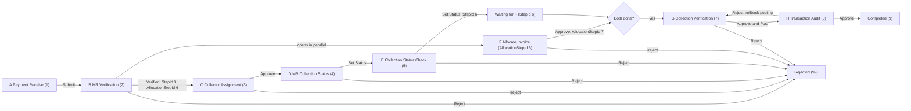

# MR Workflow: How It Works Now (A to H)

Reference for the Money Receipt (`t_payment`) multi-step workflow as it is implemented in the code today.
`MR_Workflow_Plan.md` is the original design, which was a straight A-to-G chain. The code has since changed:
- After Step B, the collection track (C to E) and Allocate Invoice (F) run **in parallel**, and Step G opens only when both are done.
- A final step, **H. Transaction Audit**, follows the posting in G. The extend rows that G posts can be reused only after H approves. An H reject rolls back the posting and sends the MR back to G.

## Tables and columns

- `t_payment.StepId`: the position on the collection track (see the step IDs below).
- `t_payment.AllocationStepId`: the Allocate Invoice track. `0` means not open, `6` means F is open, and `7` means F is approved. Added by `docs/MR_Workflow_Parallel_Tracks.sql`.
- `t_payment.StatusId`: `1` (Draft) until G is approved, then `5` (Post). An H reject sets it back to `1`. Reports that filter on `StatusId = 5` therefore count MRs that are posted, including those still waiting at H.
- `t_payment_step`: the step names (1 to 8, plus 9 Completed and 99 Rejected).
- `t_collection_status`: `1` Collected and `3` Not Collected.
- `t_payment_approval_log`: one row per Submit, Approve, or Reject (`PaymentId`, `StepId`, `Action`, `Comments`, `UserId`, `CreateTs`).
- `t_paymentitems`: the invoice items (`InvoiceItemId`) and extend rows (`PaymentExtendId`) allocated to an MR.
- `t_paymentextend`: AIT, VAT, Advance, and Due rows, created only when G posts the MR. They can be picked in F only once their MR is Completed (`StepId = 9`).
- Migrations, run manually in this order: `docs/MR_Workflow_Migration.sql`, `docs/MR_Workflow_Parallel_Tracks.sql`, `docs/MR_Workflow_Transaction_Audit.sql`.

### StepId values (collection track)

- `1` Payment Receive (A)
- `2` MR Verification (B)
- `3` Collector Assignment (C)
- `4` MR Collection Status (D)
- `5` MR Collection Status Check (E)
- `6` E is done and the MR is waiting for F. This reuses the Allocate Invoice step number.
- `7` Collection Verification (G)
- `8` Transaction Audit (H)
- `9` Completed. Before `MR_Workflow_Transaction_Audit.sql`, Completed was `8`, and that script moves those MRs to `9`.
- `99` Rejected

## Flow

Whichever of E and F finishes second opens G. Both use `mrJoinGIfReadyQuery`, which sets `StepId = 7` only when `StepId = 6` and `AllocationStepId = 7`.

## Shared backend: `backend/source/api/api_pages/mrworkflow_common.php`

- `mrGetStepDataList($stepId)` lists three groups:
  - MRs at this step, shown first.
  - MRs at any later step, view only.
  - Rejected MRs that have a log row for this step.
- `mrGetAllocationDataList()` builds the list for F from `AllocationStepId` instead of `StepId`.
- `mrGetPaymentItems($PaymentId)` returns the allocated extend rows and invoice items. Used by F, G, and H.
- `mrCheckStep($PaymentId, $stepId)` returns "already processed" when the MR is no longer at the step. This guards against double clicks and two users acting at once.
- `mrCheckAllocationOpen($PaymentId)` checks that F is still open: `AllocationStepId = 6` and the MR is neither completed nor rejected.
- `mrApproveStep($data, $stepId, $extraCols, $extraVals, $extraQuerys, $nextStepId, $afterQuerys)` runs one transaction:
  1. the `$extraQuerys`
  2. an update of `t_payment` with the extra columns and the new `StepId`
  3. the `$afterQuerys`
  4. an "Approve" log row

  The default next step comes from `mrNextStep` (step + 1, so 7 goes to 8 and 8 goes to 9 Completed).
- `mrApproveAllocation(...)` is used by F. It sets `AllocationStepId = 7`, runs the join-to-G query, and writes the log row.
- `mrRejectStep($data, $stepId, $checkFn)` requires a comment. It deletes the MR's `t_paymentitems` rows so those invoices and extend rows become free again, sets `StepId = 99`, and writes a "Reject" log row.
- `mrLogQuery` and `mrExecResult` are helpers that write the log insert and run the query batch through `exec_query`.

## Shared frontend: `src/components/MRWorkflow/`

- `MRStepPage.js`: the page shell. It handles the login and menu permission check, the navbar, notifications, and the footer, and passes `permissionType` to the screen.
- `MRStepScreen.js`: the generic step screen. It shows the list, and clicking an MR opens the detail view with the buttons below.
  - The edit icon appears only on MRs at this step. All other MRs open with a view icon and the note "This MR is at X. View only."
  - The buttons are Reject, Approve (the label is configurable), and Save (only when `renderBankEditor` is passed). They are enabled only when `permissionType === 0` and the MR is at this step.
  - Props: `stepId`, `extraColumns`, `showAllocation`, `approveLabel`, `initApproveValues`, `renderApproveFields`, `validateApprove`, `renderBankEditor`.
- `ApproveRejectModal.js`: the comment box, which is required for Reject. It can also hold extra fields for the step.
- `ApprovalHistory.js`: the log table.
- `MRHeaderView.js`: the read-only MR header card. It can embed the bank editor.
- `MRAllocationView.js`: the read-only table of allocated items and the calculation, used by G and H.

## Steps

### A. Payment Receive (StepId 1)
- Screen: `src/views/screens/paymentreceive/PaymentReceive.js` (custom screen, not `MRStepScreen`).
- API: `paymentreceive.php`. Its list shows only MRs at `StepId = 1`.
- `dataAddEdit` (Save) creates or updates the draft. A new MR gets the next MR number with `StatusId = 1` and `StepId = 1`.
- `submitData` saves the form, sets `StepId = 2` and `ReceiveSubmitDate`, and writes a "Submit" log row with an optional comment.
- `deleteData` is only allowed at step 1.

### B. MR Verification (StepId 2)
- Screen: `mrverification/MRVerification.js`, built on `MRStepScreen`. The approve button is labeled "Verified".
- API: `mrverification.php`.
- Approve sets `AllocationStepId = 6`, which opens F, and `StepId = 3`, which starts C.
- Reject closes the MR.

### C. Collector Assignment (StepId 3)
- Screen: `collectorassignment/CollectorAssignment.js`, with a bank-fields editor in the header.
  - Read-only: bank, branch, cheque number and date, payment mode, currency, FC amount, exchange rate, and BDT amount.
  - Editable: Collected By, collection person name and phone, collection address, and remarks.
- API: `collectorassignment.php`.
  - `saveData` saves those fields without moving the MR.
  - `approveData` saves them and moves the MR to `StepId = 4`.
- Note: the collector dropdown planned in the original design (`CollectorUserId`) is not used on this screen.

### D. MR Collection Status (StepId 4)
- Screen: `mrcollectionstatus/MRCollectionStatus.js`. The approve button is labeled "Set Status".
- The approve modal asks for:
  - Collection Status, required. The choices are Collected and Not Collected.
  - Collection Date, optional.
- API: `mrcollectionstatus.php`. Approve saves `CollectionStatusId` and `CollectionDate` and moves the MR to `StepId = 5`.

### E. MR Collection Status Check (StepId 5)
- Screen: `mrcollectionstatuscheck/MRCollectionStatusCheck.js`. The approve button is labeled "Set Status".
- The list adds Collection Status and Collected Amount columns.
- The approve modal asks for Collection Status and Collection Date. Both are required, and the date defaults to today.
- API: `mrcollectionstatuscheck.php`. Approve saves the status and date and sets `StepId = 6`, which means waiting for F. In the same transaction, `mrJoinGIfReadyQuery` moves the MR straight to `StepId = 7` if F is already approved.

### F. Allocate Invoice (AllocationStepId 6, parallel with C to E)
- Screen: `allocateinvoice/AllocateInvoice.js` and `AllocateInvoiceAddModal.js` (custom screen). The buttons are Save, Reject, Approve, and Add Invoice. They are editable only while `AllocationStepId = 6` and the MR is neither completed nor rejected.
- API: `allocateinvoice.php`. The list comes from `mrGetAllocationDataList`.
- `getUnpaidInvoices` lists the customer's unfinished, unallocated extend rows whose MR is Completed (`StepId = 9`, so not rows still waiting at H), then invoice items that are unpaid and not allocated (`IsPaid = 0`, no `t_paymentitems` row, `AdjFlag` null or `Approved`). It can be filtered by bill number or date range.
- `addInvoicesToPayment` and `deletePaymentItem` add and remove rows in `t_paymentitems`. Duplicates are skipped.
- `dataAddEdit` (Save) stores only the calculation fields: Remarks, Rebate, CN, AIT, VAT, Advance, and Due (percent and amount).
- `approveData` saves the calculation and sets `AllocationStepId = 7`, and moves the MR to G if E is already done. It needs at least one allocated item or an Advance amount greater than 0.
- Reject uses `mrRejectStep` with the `mrCheckAllocationOpen` check.
- No posting happens here.

### G. Collection Verification (StepId 7): the posting step
- Screen: `collectionverification/CollectionVerification.js`, built on `MRStepScreen` with `showAllocation`. The approve button is labeled "Approve & Post", and the list adds Due Amount and Advance Amount columns.
- The detail view shows the header, the allocated items and calculation (read-only), and the history. There are no extra fields to fill in.
- API: `collectionverification.php`. `approveData` runs one transaction:
  1. It inserts `t_paymentextend` rows (`RptNumber = MRNo`) for each amount greater than 0: AIT (type 3, `AitDeduction`), VAT (4, `VatAmount`), Advance (5, `AdvanceAmount`), and Due (6, `DueAmount`).
  2. It sets `t_invoiceitems.IsPaid = 1` for every allocated invoice item.
  3. It sets `t_paymentextend.IsFinished = 1` for every allocated extend row (earlier advances or dues that this MR consumes).
  4. It sets `TotalBaseAmount` and `TotalTransactionAmount` to the sums over the allocated **invoice items only**.
  5. It sets `StatusId = 5`, `PostUserId` to the current user, and `StepId = 8` (Transaction Audit).
  6. It writes an "Approve" log row.
- Reject deletes the `t_paymentitems` rows and sets `StepId = 99`. Nothing has been posted yet, so nothing else needs undoing.

### H. Transaction Audit (StepId 8)
- Screen: `transactionaudit/TransactionAudit.js`, built on `MRStepScreen` with `showAllocation`. It has the same list columns and detail view as G, and the buttons are Approve and Reject.
- API: `transactionaudit.php`.
- Approve calls `mrApproveStep`, which sets `StepId = 9` (Completed) and writes the log row. From then on, the extend rows posted by G can be picked in F.
- Reject requires a comment and rolls back the G posting in one transaction:
  1. It deletes this MR's own `t_paymentextend` rows (`WHERE PaymentId = <this MR>`).
  2. It sets `t_invoiceitems.IsPaid = 0` for the allocated invoice items.
  3. It sets `t_paymentextend.IsFinished = 0` for the extend rows from earlier MRs that this MR used.
  4. It sets `StatusId = 1`, `PostUserId = NULL`, and `StepId = 7`, which sends the MR back to G.
  5. It writes a "Reject" log row at step 8.

  The `t_paymentitems` rows are kept, so the invoices stay allocated. The totals are not reset, because G recalculates them when it approves again.
- Safety check: the reject is refused if any of this MR's extend rows is already allocated to another MR. This should not happen, because F only offers extend rows from Completed MRs.

### Completed (9) and Rejected (99)
- Completed and rejected MRs stay visible as view-only rows in the lists of the steps they passed. They can no longer be acted on anywhere.
- When an MR is rejected, its allocated invoices and extend rows become free again for other MRs.

## Wiring

- Routes: `src/index.js`.
- Navbar items: `src/components/Navbars/AfterLoginNavbar.js`. Each item is wrapped in `menuShowPermision("<menukey>")`.
- Menus: `t_menu` rows under `moneyreceipt` (144). Access is granted through `t_role_menu_map` or the Role to Menu Permission screen.
- Menu keys and API pages: `paymentreceive`, `mrverification`, `collectorassignment`, `mrcollectionstatus`, `mrcollectionstatuscheck`, `allocateinvoice`, `collectionverification`, `transactionaudit`.

## Known quirks

- `StepId = 6` means two different things depending on the track: "E done, waiting for F" on the collection track, and "Allocate Invoice open" when stored in `AllocationStepId`.
- G approve checks the step twice, once in `approveData` and again in `mrApproveStep`. This is harmless.
- The G screen sends `rowData` with the request, but the G backend never reads it.
- `TotalBaseAmount` does not include allocated extend rows.
- D allows an empty collection date. E requires it.
