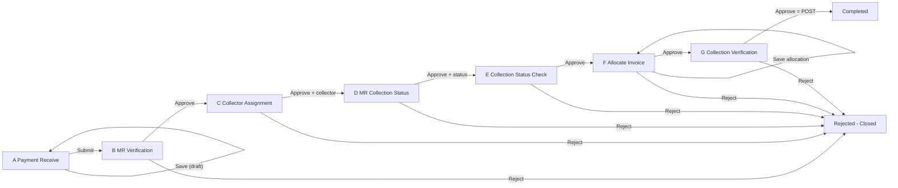

# MR Multi-Step Workflow (A to G)

Add a step-based approval workflow (A to G) to the Money Receipt (`t_payment`). A column tracks the current step, a log table stores every submit, approve, and reject with its comment, and each step has its own menu that lists only the MRs waiting at that step. Step F keeps the current allocate-invoice table and calculation. All financial posting (`t_paymentextend` rows, `t_invoiceitems.IsPaid`, totals, `IsFinished`) happens only when Step G is approved. A rejection at any step closes the MR.

## Core idea
- Each MR (`t_payment` row) has a `StepId` that says which step it is waiting at.
- Each menu lists only the MRs where `StepId` equals its own step. Approving moves the MR to the next step, and rejecting closes it (`StepId = 99`).
- Every Submit, Approve, and Reject is written to `t_payment_approval_log` with its comment, and every step screen shows that history.
- No financial posting happens before Step G. Step F only allocates invoices and saves the calculation. Approving Step G does the real posting.

## Step summary
- **A. Payment Receive (`paymentreceive`, StepId 1):** create or edit the MR header. Save keeps it as a draft. Submit (with an optional comment) moves it to step 2.
- **B. MR Verification (`mrverification`, StepId 2):** read-only MR view. Approve or reject with a comment.
- **C. Collector Assignment (`collectorassignment`, StepId 3):** choose a collector (required), then approve or reject with a comment.
- **D. MR Collection Status (`mrcollectionstatus`, StepId 4):** enter the collection status, date, amount, and note, then approve or reject with a comment.
- **E. MR Collection Status Check (`mrcollectionstatuscheck`, StepId 5):** read-only view of the C and D data. Approve or reject with a comment.
- **F. Allocate Invoice (`allocateinvoice`, StepId 6):** the current table and calculation stay as they are. Add or remove invoice and extend items, and Save stores the amounts. Approve or reject with a comment.
- **G. Collection Verification (`collectionverification`, StepId 7):** read-only view of the MR, its allocated items, and the calculation. Approve posts everything. Reject closes the MR.
- **Completed (StepId 8) / Rejected (StepId 99):** the MR no longer appears in any step menu.

## 1. Database changes (SQL script, run manually in `cms_db1`)
- New lookup table `t_payment_step` (`StepId`, `StepName`, `SortOrder`): 1 to 7 as listed above, plus 8 Completed and 99 Rejected.
- New columns on `t_payment`:
  - `StepId` INT NOT NULL DEFAULT 1
  - Step C: `CollectorUserId` INT NULL, `CollectorAssignDate` DATETIME NULL
  - Step D: `CollectionStatusId` INT NULL, `CollectionDate` DATE NULL, `CollectedAmount` DECIMAL NULL, `CollectionNote` VARCHAR(500) NULL
- New lookup table `t_collection_status` (for example Collected, Partially Collected, Not Collected).
- New table `t_payment_approval_log`: `LogId` PK, `PaymentId`, `StepId`, `Action` ('Submit'/'Approve'/'Reject'), `Comments` VARCHAR(1000), `UserId`, `CreateTs` DEFAULT CURRENT_TIMESTAMP, with an index on `PaymentId`.
- Backfill existing rows: `StatusId = 5` becomes `StepId = 8`, and all other rows get `StepId = 1`.
- Menus: add `t_menu` rows under parent `moneyreceipt` (144) for `collectorassignment`, `mrcollectionstatus`, `mrcollectionstatuscheck`, and `collectionverification`. `paymentreceive` (146), `mrverification` (145), and `allocateinvoice` (139) already exist. Fix `SortOrder` so the menu reads A to G, then grant access in `t_role_menu_map`, either with SQL or through the Role to Menu Permission screen.
- Meaning of `StatusId`: it stays 1 (Draft) through steps A to F and becomes 5 (Post) only when Step G is approved. Existing reports that filter on `StatusId = 5` therefore still count only fully posted MRs.

## 2. Backend

### Shared file: `backend/source/api/api_pages/mrworkflow_common.php` (included by each step API)
- `getStepDataList($stepId)`: the current `t_payment` list query with `WHERE a.StepId = ?`, joined to the customer, bank, collector name, and collection status name.
- `getApprovalLog($PaymentId)`: returns the log rows joined to the step name and user name, oldest first.
- `approveStep($data, $stepId, $extraCols = [], $extraVals = [], $extraQuerys = [])`:
  - Checks `SELECT StepId FROM t_payment WHERE PaymentId = ?`. If the MR is no longer at `$stepId`, it returns "already processed", which blocks a double click or two users acting at once.
  - Builds one update on `t_payment` with the extra columns plus `StepId = next`, adds any `$extraQuerys` (used by Step G for posting), adds a log insert, and runs everything in one `exec_query` batch so it is transactional.
- `rejectStep($data, $stepId)`: the comment is required. Sets `StepId = 99`, deletes this MR's `t_paymentitems` rows so the invoices and extend items become free again, and inserts a log row, all in one batch.

### A. `backend/source/api/api_pages/paymentreceive.php`
- `getDataList` returns only `StepId = 1`.
- `dataAddEdit` (Save) inserts or updates the draft without changing `StepId`. `StatusId` stays 1.
- New `submitData`: saves the latest form data first, then sets `StepId = 2` and `ReceiveSubmitDate`, and writes a 'Submit' log row with the optional comment. It is only allowed while `StepId = 1`.
- `deleteData` is only allowed while `StepId = 1`.

### B to E. Step APIs
- `mrverification.php` (step 2): rewritten to `getDataList`, `approveData`, `rejectData`, and `getApprovalLog`. It no longer allows free edits.
- New `collectorassignment.php` (step 3): `getCollectorList` returns users from `t_users`. `approveData` requires `CollectorUserId` and also saves `CollectorAssignDate`.
- New `mrcollectionstatus.php` (step 4): `getCollectionStatusList`. `approveData` saves `CollectionStatusId`, `CollectionDate`, `CollectedAmount`, and `CollectionNote`.
- New `mrcollectionstatuscheck.php` (step 5): approve and reject only.

### F. `allocateinvoice.php`: allocation and calculation only
- `getDataList` returns only `StepId = 6`.
- Remove new-MR creation (the insert branch of `dataAddEdit` and `getNextMRNumber` use) and the header delete (`deleteData`), because MRs now come only from Step A.
- Keep `getUnpaidInvoices`, `addInvoicesToPayment`, `deletePaymentItem`, and `getDataSingle` unchanged. `addInvoicesToPayment` and `deletePaymentItem` are only allowed while the MR is at `StepId = 6`.
- `dataAddEdit` (Save) only updates the calculation fields on `t_payment`: `RebatePercent/Amount`, `CNPercent/Amount`, `AitPercent`/`AitDeduction`, `VatPercent/Amount`, `AdvanceAmount`, `DueAmount`, and `Remarks`. Remove the whole `if ($StatusId == 5)` block (the `t_paymentextend` inserts) and the post-update queries after it (lines 474-591 today). They move to Step G.
- New `approveData`: requires at least one `t_paymentitems` row and saves the latest calculation values. Then it calls `approveStep(..., 6)`, which moves the MR to `StepId = 7` with a log row.
- New `rejectData`: calls `rejectStep(..., 6)`, which releases the items and closes the MR.

### G. New `collectionverification.php` (step 7): the posting step
- `getDataList` returns `StepId = 7`. `getDataSingle` reuses the Step F items query (invoice and extend rows) and header amounts so the reviewer sees the same table and calculation, read-only.
- `approveData` builds `$extraQuerys` and passes it to `approveStep(..., 7)`, so it all runs in one transaction:
  1. Insert into `t_paymentextend` (`PaymentId`, `PaymentExtendTypeId`, `RptNumber = MRNo`, `Amount`) for each amount above 0: AIT (type 3), VAT (4), Advance (5), Due (6). This logic is moved from `allocateinvoice.php`.
  2. `UPDATE t_invoiceitems SET IsPaid = 1 WHERE InvoiceItemId IN (SELECT InvoiceItemId FROM t_paymentitems WHERE PaymentId = ? AND InvoiceItemId IS NOT NULL)`.
  3. `UPDATE t_payment ... SET TotalBaseAmount, TotalTransactionAmount` from the sum of the linked invoice items.
  4. `UPDATE t_paymentextend SET IsFinished = 1 WHERE PaymentExtendId IN (SELECT PaymentExtendId FROM t_paymentitems WHERE PaymentId = ? AND PaymentExtendId IS NOT NULL)`.
  5. `t_payment`: `StatusId = 5`, `PostUserId = UserId`, `StepId = 8`.
  6. A log row ('Approve', step 7, comment).
  - If `exec_query` cannot run the raw `UPDATE ... IN (SELECT ...)` statements inside its batch, run steps 2 to 4 immediately after a successful batch using the same `$dbh`, as the code does today. Either way, they run only after the step check passes.
- `rejectData`: calls `rejectStep(..., 7)`. Nothing has been posted yet, so the only cleanup is releasing the `t_paymentitems` rows.

### Invoice availability
- `getUnpaidInvoices` already excludes anything that has a `t_paymentitems` row, so an invoice allocated to an MR at step F or G cannot be picked by another MR. Because rejection deletes that MR's `t_paymentitems` rows, rejected allocations become available again automatically.

## 3. Frontend (React)
- Shared components in `src/components/MRWorkflow/`:
  - `ApproveRejectModal.js`: a comment box (required for Reject, optional for Approve and Submit), an optional slot for extra fields (children), and Approve and Reject buttons.
  - `ApprovalHistory.js`: a table of the log rows (step, action, comment, user, date and time).
  - `MRHeaderView.js`: a read-only MR header card reused by steps B to G.
- Screens (`index.js` with `menukey` plus a screen component, same pattern as `mrverification`):
  - `paymentreceive/`: Save and Submit buttons, a Submit action on each draft row, and a comment box on Submit.
  - `mrverification/`: list, then view, then Approve or Reject.
  - `collectorassignment/`: the modal adds a required Collector dropdown.
  - `mrcollectionstatus/`: the modal adds status, date, amount, and note.
  - `mrcollectionstatuscheck/`: view with the collector and collection data, then Approve or Reject.
  - `allocateinvoice/`: keep `AllocateInvoice.js` and `AllocateInvoiceAddModal.js` (table and calculation). Remove "Add MR" and "Delete MR", keep "Save". Replace "Post" with "Approve" and "Reject", which save the calculation first and then open the modal.
  - `collectionverification/`: read-only header, items table, and calculation (reusing the Step F table in read-only mode), plus history, then Approve (Post) or Reject.
- Add the routes in `src/index.js` near lines 99-101.
- Add the navbar items in `src/components/Navbars/AfterLoginNavbar.js` near lines 322-350, in A to G order, each wrapped in `menuShowPermision("<menukey>")`.

## 4. Implementation tasks
- [x] SQL: `t_payment_step`, `t_collection_status`, `t_payment_approval_log`, new `t_payment` columns, backfill, `t_menu` and `t_role_menu_map` rows (see `docs/MR_Workflow_Migration.sql`, run manually)
- [x] Create `mrworkflow_common.php` with `getStepDataList`, `getStepDataSingle`, `approveStep`, `rejectStep`, `getApprovalLog`
- [x] Step A: `paymentreceive.php` and UI. List `StepId = 1`, keep Save (draft), add a separate Submit that moves the MR to step 2 with a log row and optional comment
- [x] Step B: convert `mrverification.php` and UI to step 2 approve/reject with comments
- [x] Steps C, D, E: create the `collectorassignment` (3), `mrcollectionstatus` (4), and `mrcollectionstatuscheck` (5) APIs and screens
- [x] Step F: refactor `allocateinvoice`. List `StepId = 6`, keep the table and calculation, make Save store only the amounts, remove the posting logic, add approve (to step 7) and reject (release `t_paymentitems`)
- [x] Step G: create `collectionverification` (7). Read-only MR, items, and calculation. Approve runs the posting (`t_paymentextend` inserts, `IsPaid`, totals, `IsFinished`, `StatusId = 5`, `StepId = 8`). Reject releases the items
- [x] Make sure `getUnpaidInvoices` ignores `t_paymentitems` rows of rejected MRs (handled by the delete on reject)
- [x] Build the shared `ApproveRejectModal`, `ApprovalHistory`, and `MRHeaderView` components
- [x] Register the routes in `src/index.js` and the navbar items in `AfterLoginNavbar.js` (A to G order)

## 5. Testing checklist
- Take an MR from A to G. It should appear in exactly one menu at a time.
- Before Step G approval, `t_paymentextend` has no new rows, `IsPaid` is 0, and `StatusId` is 1. After approval, all posting is done, `StatusId` is 5, and `StepId` is 8.
- Reject at F or G: the invoices show up again in `getUnpaidInvoices` for a new MR.
- Approving the same MR twice (two tabs) gives "already processed" on the second attempt.
- The history shows every action with its comment.

## 6. Optional follow-up
- A read-only "MR Status Tracker" report that lists all MRs with their current step, including completed and rejected ones.
